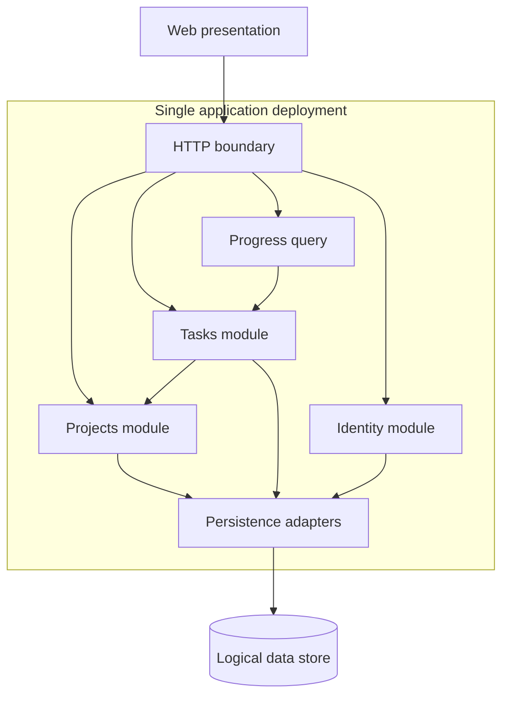

# Architecture

## Approved decisions — November 15, 2026

The product owner approved the seven-feature MVP, project members updating any task within their own project, a modular monolith, technology-neutral design, create/list task API operations, and a project task screen with progress and a creation form. They subsequently approved secure cookie sessions, the task rules below, concealed project existence through 404 responses, 400 validation errors, and pagination defaults of 20 with a maximum of 100. Task descriptions must be mandatory.

## Alternatives and decision

| Option | Benefits for this MVP | Costs | Decision |
| --- | --- | --- | --- |
| Traditional monolith | Simple deployment and local calls | Boundaries are easier to blur as features grow | Considered |
| Modular monolith | One deployment with explicit business boundaries and local transactions | Requires discipline to preserve module ownership; scales as a whole | Approved |
| Microservices | Independent deployment and selective scaling | Network failures, distributed consistency, and additional operations | Deferred; no confirmed requirement justifies these costs |

Use one application deployment with internal modules. This choice does not select a language, framework, database engine, cloud provider, or frontend rendering strategy. Existing Java/Maven files are an unapproved scaffold.

## Components and responsibilities

| Component | Responsibility |
| --- | --- |
| Web presentation | Render projects, task list, progress, form validation, and error/loading states |
| HTTP boundary | Parse requests, establish identity, enforce session and CSRF protections, map errors to the contract |
| Identity module | Resolve users and server-managed sessions; account provisioning remains pending |
| Projects module | Own projects and memberships; provide project authorization decisions |
| Tasks module | Own task creation, assignment and status rules; request membership checks from Projects |
| Progress query | Derive counts from all authorized project tasks, not just the visible page |
| Persistence adapters | Store and retrieve entities, preserve integrity and transaction boundaries |

Each module owns its rules and accesses other modules through explicit interfaces, not their internal persistence implementation. A shared logical data store is proposed for this monolith; the physical database and storage mapping remain undecided. Membership validation and task creation must be atomic relative to membership changes when those changes are introduced.

## Request flow

1. Resolve the server session. Unauthenticated requests receive 401.
2. On writes, check the CSRF token associated with the session; invalid or missing tokens receive 403.
3. Resolve the project and membership. Both missing and inaccessible projects receive the same generic 404.
4. Validate normalized input. Invalid fields receive 400 with field details only after project access is established.
5. Create a task with status `todo` and no assignee. Commit before returning 201.
6. The UI shows the confirmed task and refreshes the list. Retries after uncertain network outcomes require a future idempotency decision; the client must not claim success without confirmation.

## Session and security design

The user approved server-managed sessions carried by a secure cookie. Proposed contract details: cookie `matriz_session`, HttpOnly, Secure, SameSite=Lax, Path=/, no Domain attribute. The server stores session state; logout invalidates the session. Use HTTPS. Write requests also carry an `X-CSRF-Token` validated against the session. Cookie naming, CSRF delivery, expiry, renewal, and deployment origin need technical review before implementation. A missing or invalid CSRF token is a 403; project authorization failures use 404. Do not log cookies or tokens.

## Scope of this pack

OpenAPI documents only creating and listing tasks, as required by the assignment. Sign-in, sign-out, project and membership management, assignment, status updates, and project-wide progress remain MVP features but their endpoints are not yet specified. The wireframe includes their intended UI affordances without implying API implementation.

## Critical review and open issues

| Finding | Resolution or status |
| --- | --- |
| Earlier descriptions were optional | Changed across the specification, stories, model, contract and wireframe; blank descriptions are rejected |
| Page totals could be mistaken for project progress | Progress uses the entire project; its API is explicitly outside the two-operation contract |
| Session cookies alone do not specify CSRF protection | Added a proposed token header and 403 response for create requests |
| IDs could expose other projects | Both missing and inaccessible projects use generic 404, as approved |
| Only two endpoints could appear to cover the entire MVP | Explicitly documented the remaining API work |
| Persistence and deployment could silently select technologies | Logical model only; no engine, framework or hosting selected |

Still pending: account provisioning/recovery, privacy and retention policies, performance targets, concurrency and retry handling, physical persistence, and detailed session lifecycle. Technical details labelled proposed have not been approved simply by being written here. Human review of the final pack and approval of the commit message are required before committing.
