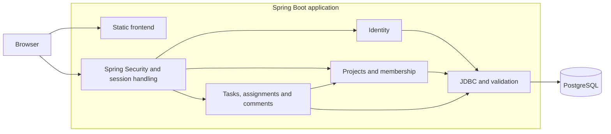

# Matriz architecture

The approved modular monolith runs as one Java 21 / Spring Boot process. It serves a same-origin HTML, CSS, and JavaScript frontend plus the JSON REST API. PostgreSQL is the persistent service and Flyway manages schema migrations.

A modular monolith keeps deployment and database transactions simple while preserving project, identity, and task responsibilities. An independently deployed services architecture was deferred because the lab does not require independent scaling or deployments.

The server resolves identity from a session cookie, checks CSRF on writes, and checks project membership for protected resources. Missing and inaccessible projects share a generic 404. Managers control project edits, deletions, and memberships. Members can manage tasks and collaboration within their projects. Versions protect project/task edits and deletions against stale writes. Persistent records survive a restart, while in-memory sessions require sign-in again.

Docker Compose runs one application container and one PostgreSQL container. The app is exposed on loopback. The database uses a named volume and an internal connection. See [README](../README.md) and [API](../openapi.yaml).
