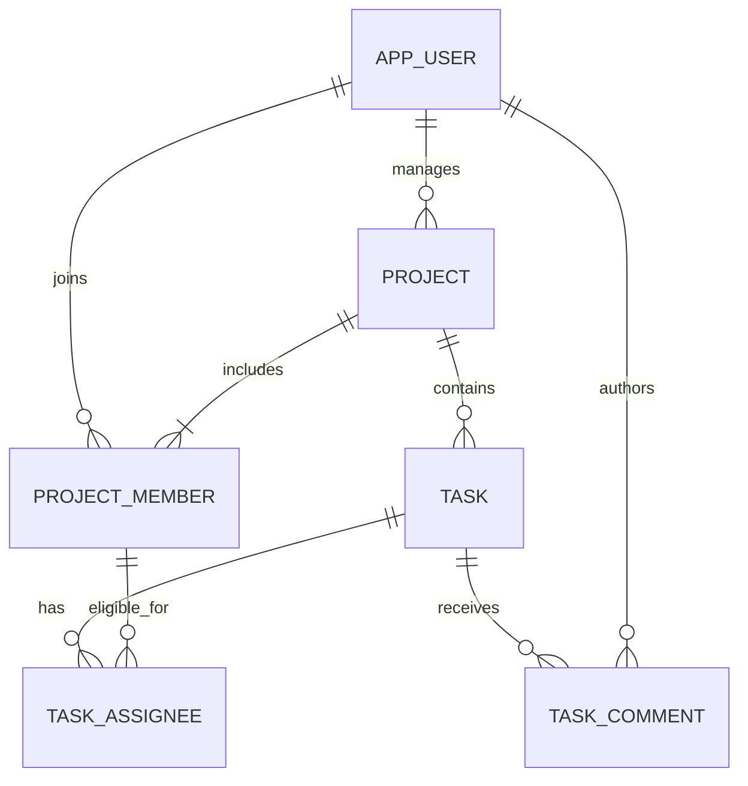

# Matriz data model

PostgreSQL stores users, projects, memberships, tasks, assignees, and comments. The [Flyway migration](../src/main/resources/db/migration/V1__initial_schema.sql) defines their fields and constraints. Spring keeps the current server session in memory.

Projects and tasks use UUIDs and version counters. Project creation also inserts the creator's membership. The task title and description are required. Tasks start as todo and medium priority. Task assignments are unique per task and user. Composite foreign keys enforce membership in the task's project. Comments store the authenticated author and a database timestamp.

Deleting a project deletes its memberships and tasks. Deleting a task deletes its comments and assignments. Progress derives from all project tasks and stays independent of pagination or filters. The optional demo seed uses a marker to avoid reseeding on restart.
