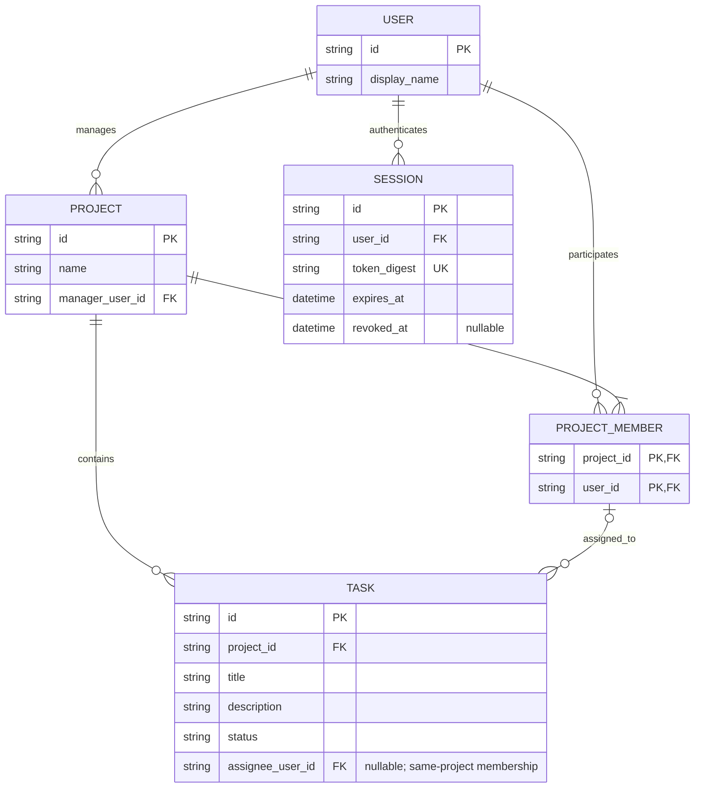

# Logical data model

Technology-neutral model for the approved modular monolith. Entity names and IDs are design proposals. No database engine, ORM, migration syntax or identifier generation scheme is selected. API IDs are opaque strings.

## Entities and attributes

| Entity | Attributes and constraints |
| --- | --- |
| User | `id` unique identifier; `display_name` required; credential representation pending identity design |
| Project | `id`; `name` trimmed, 1–100 characters (existing assumption); `manager_user_id` references User |
| ProjectMember | Composite identity (`project_id`, `user_id`); both reference existing entities |
| Task | `id`; `project_id`; `title` trimmed, 1–120 characters; mandatory `description`, 1–2000 characters after trimming; `status` in todo/in_progress/done; nullable `assignee_user_id` |
| Session | `id` internal identifier; `user_id`; `token_digest` unique; `expires_at`; nullable `revoked_at`; storage and token mechanisms pending technical review |

Description normalization follows the title's trim rule: blank or whitespace-only values are invalid. This is a proposed precise interpretation of the owner's mandatory-description requirement. No raw session secret is stored in the logical model. CSRF state and account provisioning details remain part of identity design.

## Relationships and integrity

- A User manages zero or more Projects; each Project has exactly one manager.
- Users and Projects have a many-to-many relationship through ProjectMember. Every Project has at least one membership, including its manager.
- A Project has zero or more Tasks; each Task belongs to exactly one Project.
- A Task has zero or one assignee. If assigned, (`project_id`, `assignee_user_id`) must identify a ProjectMember in that same project.
- A User has zero or more Sessions; each Session belongs to exactly one User.
- Project creation and creator membership form one atomic operation. Manager membership and assignee membership require explicit integrity enforcement; simple foreign keys to User alone are insufficient.
- No cascading deletion policy is chosen. Deletion, member removal and manager transfer are outside this MVP and require retention and reassignment decisions.

## Mermaid ER diagram

The Task-to-ProjectMember relationship represents a composite same-project membership constraint, not a global user-only reference. The diagram alone does not enforce the manager-must-be-member rule.

## Derived values and pagination

Progress is calculated from all tasks in a project: done / total × 100, rounded to one decimal. A project with no tasks displays “No tasks” and total 0. Do not persist a duplicate progress value in this model. Task-list pagination uses a stable ID ordering as a draft convention; default limit 20, maximum 100. Offset pagination is not a snapshot and may shift under concurrent writes. Strong concurrency and retry guarantees remain pending.
